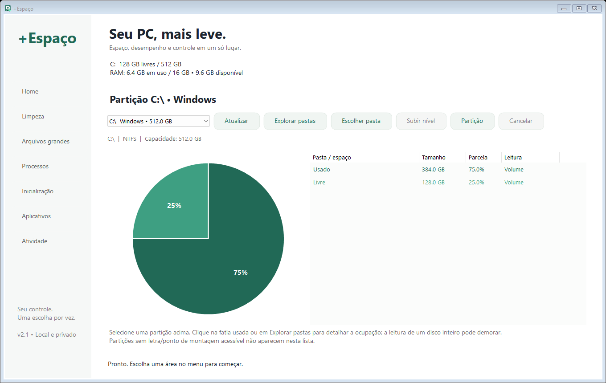
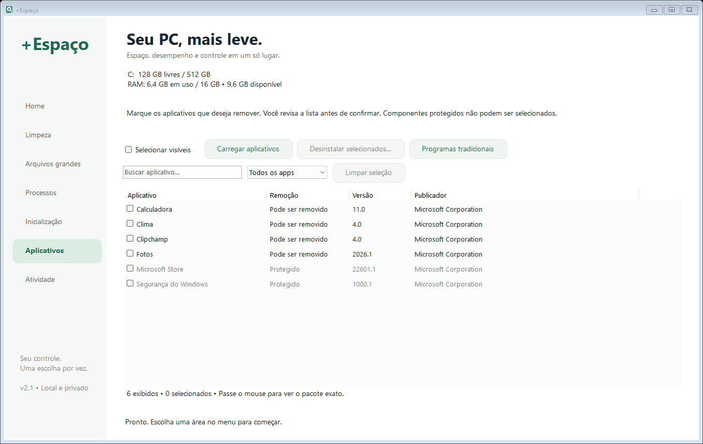

# +Espaço


Aplicativo portátil para Windows, em português, para revisar espaço em disco, processos, inicialização e aplicativos instalados.

[Baixar a versão mais recente](https://github.com/brunoxy01/MoreSpace/releases/latest)



## O que faz

- Home com gráfico de pizza de espaço usado/livre para cada partição montada e acessível.
- Exploração por pasta: clique na fatia usada para analisar o disco; depois clique em uma pasta no gráfico ou dê duplo clique na lista para descer um nível. Use **Subir nível** para voltar e **Cancelar** para interromper a leitura.
- Analisa temporários antigos e permite excluir somente os arquivos selecionados.
- Localiza arquivos grandes para revisão no Explorer.
- Mostra processos, CPU, RAM, PID e caminho do executável, com busca e ordenação.
- Habilita ou desabilita entradas de inicialização reconhecidas, após revisão.
- Permite marcar vários aplicativos Store/Appx, filtrar sem perder a seleção e revisar o lote antes de remover.
- Protege componentes essenciais conhecidos e registra resultados por aplicativo.
- Usa botões arredondados, feedback animado ao passar o mouse/clicar e listas com desenho em buffer para reduzir cintilação.

## Executar

Windows 10/11 **x64**, .NET Framework 4.8 e Windows PowerShell 5.1. Baixe `MoreSpace.exe` em Releases e abra. A janela e os metadados usam o nome **+Espaço**. Não é necessário instalar.

O executável não tem assinatura digital comercial. Algumas alterações em entradas de inicialização de todos os usuários exigem privilégios adicionais; falhas são exibidas em Atividade.

## Selecionar aplicativos

1. Abra **Aplicativos → Carregar aplicativos**.
2. Marque programas individualmente ou use **Selecionar visíveis**. Componentes protegidos não podem ser marcados.
3. A seleção permanece ao pesquisar ou trocar o filtro; o rodapé mostra quantos selecionados estão fora do filtro.
4. Clique em **Desinstalar selecionados…** e revise todos os nomes e pacotes na confirmação.
5. A remoção acontece um aplicativo por vez. **Parar após o atual** preserva os próximos da fila. Falhas e itens não iniciados continuam selecionados.

Remover aplicativos pode apagar seus dados locais. O app usa `Remove-AppxPackage` apenas para a conta atual, não remove provisionamento para futuras contas e não garante que todo pacote seja removível. Programas tradicionais são gerenciados pelo botão que abre as Configurações do Windows.

O filtro Microsoft não comprova instalação de fábrica. O programa não consegue determinar automaticamente tudo que é inútil nem garante uma quantidade de espaço ou RAM recuperada. A limpeza de temporários é permanente; revise os caminhos antes de confirmar. RAM é liberada ao fechar aplicativos, sem esvaziamento artificial de cache.

A primeira leitura de um disco inteiro pode demorar. A distribuição por pastas soma tamanhos lógicos dos arquivos acessíveis e ignora links, portanto pode diferir do espaço físico usado. Entradas inacessíveis são contadas, e pastas com falhas são identificadas como parciais. O gráfico de partição usa os totais informados pelo Windows; partições não montadas não são exibidas.



## Compilar e testar

Não é necessário instalar o SDK do .NET. No PowerShell, a partir da raiz do repositório:

```powershell
.\build.ps1
```

O script usa o compilador do .NET Framework instalado no Windows, gera `dist/MoreSpace.exe` com o ícone embutido e executa:

- `--self-test`: scanner, cancelamento e validação de temporários em pasta de teste.
- `--management-test`: estados de inicialização em chaves fictícias isoladas e inventário somente leitura de pacotes.
- `--space-test`: soma de tamanhos, navegação em subpastas e cancelamento em uma árvore de arquivos fictícia.
- `--ui-test`: seleção individual/global, bloqueio de protegidos, persistência ao filtrar e limpeza da seleção com dados fictícios.

Esses testes **não desinstalam aplicativos reais nem alteram entradas reais de inicialização**. A desinstalação real e a aparência em todas as escalas de DPI ainda dependem de validação em cada ambiente.

Para gerar a imagem demonstrativa da documentação:

```powershell
.\dist\MoreSpace.exe --preview-demo "$PWD\docs\home.png" 0
.\dist\MoreSpace.exe --preview-demo "$PWD\docs\interface.png" 5
```

## Estrutura

- `src/`: interface Windows Forms, scanner, gerenciadores e testes.
- `assets/`: logo PNG, ícone ICO em sete resoluções e conversor de formato.
- `docs/GUIA.txt`: funcionamento, limites e referências técnicas.
- `.github/workflows/build.yml`: compilação e testes no Windows.

Registros e backups ficam em `%LOCALAPPDATA%\MaisEspaco`. O app não envia telemetria. Revise os logs antes de compartilhar, pois contêm caminhos e nomes de programas.

## Identidade visual

A logo foi criada com a ferramenta integrada de geração de imagens. O [brief de geração](assets/LOGO.md) acompanha o PNG original. O arquivo `app.ico` contém tamanhos de 16 a 256 pixels e pode ser reconstruído com `assets/Build-Icon.ps1`.
