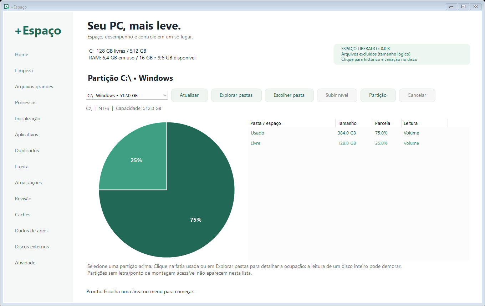
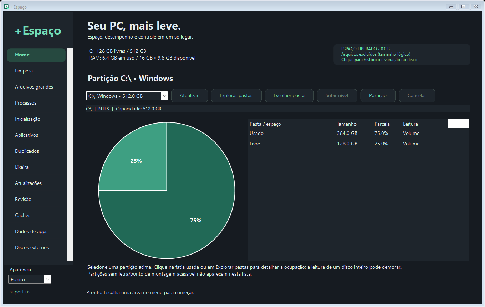
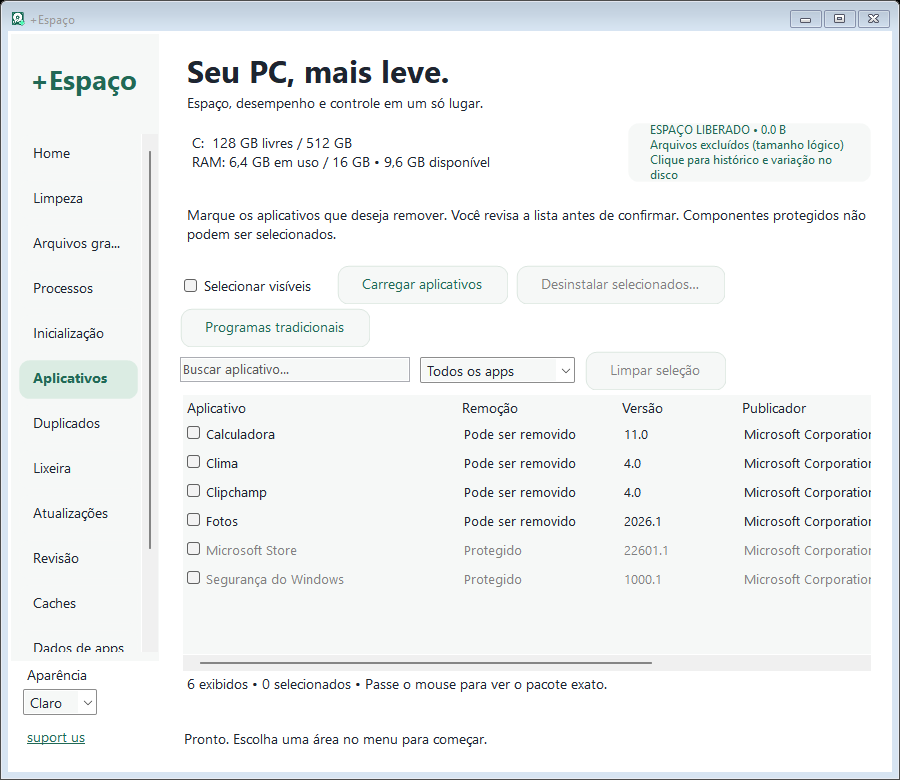
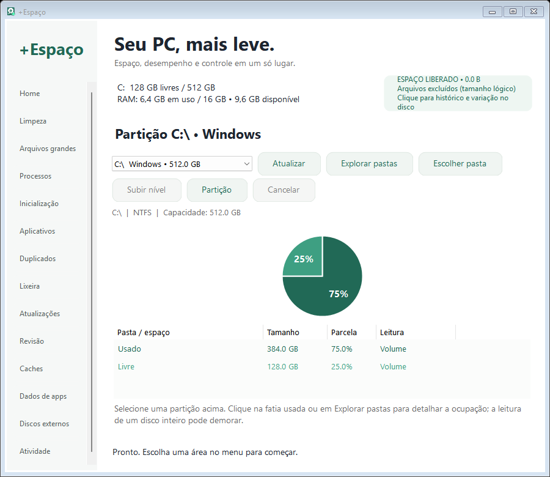
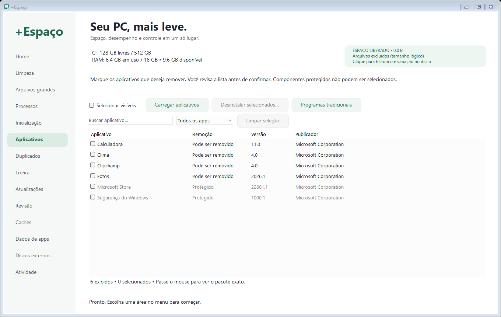
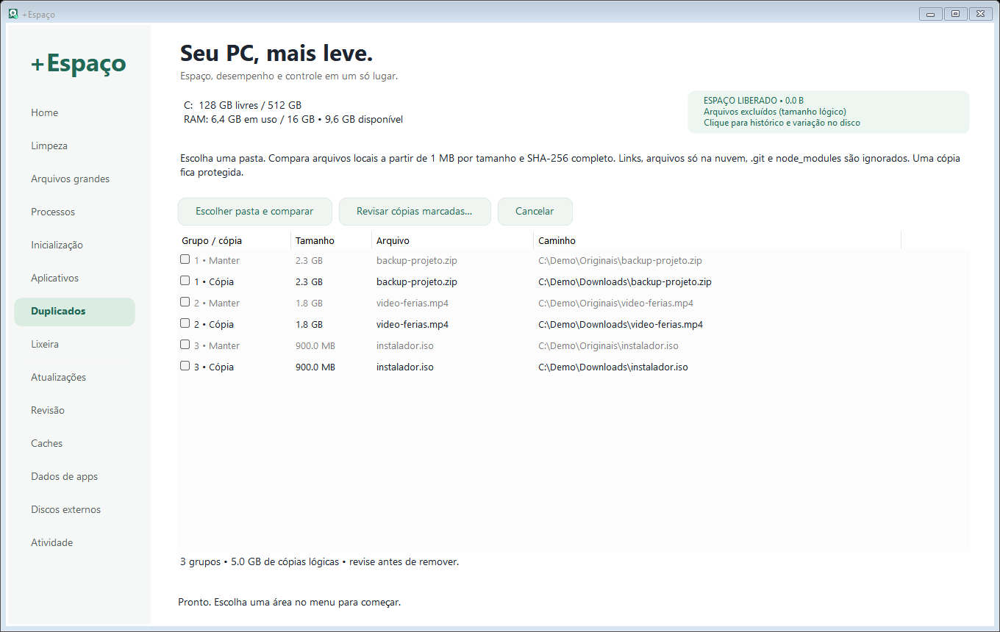
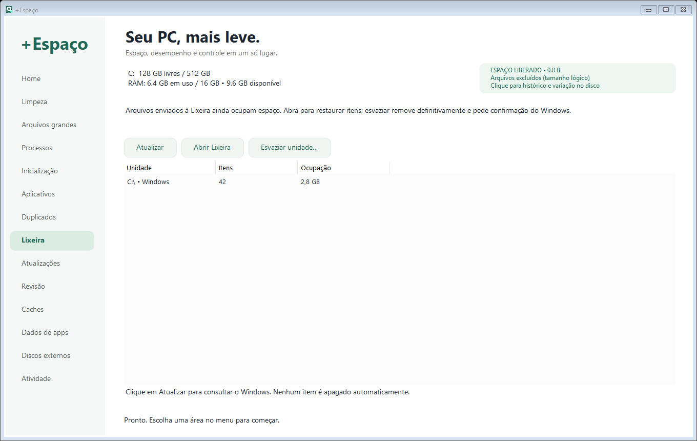
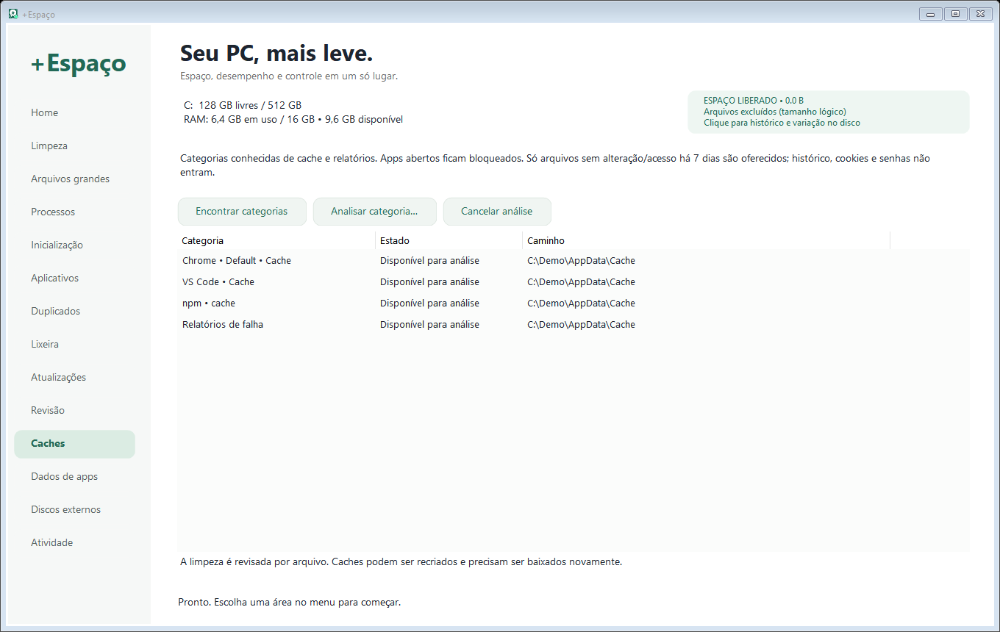
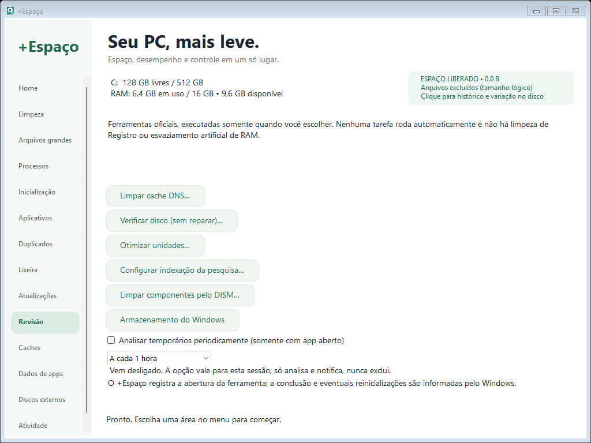

<div align="center">


# +Espaço

### Seu PC, mais leve. Suas escolhas, mais claras.

Disco, arquivos, aplicativos e manutenção do Windows em um utilitário portátil, em português.

[](#começar)
[](https://github.com/brunoxy01/MoreSpace/releases/latest)
[](https://github.com/brunoxy01/MoreSpace/releases)
[](https://github.com/brunoxy01/MoreSpace/releases/latest/download/MoreSpace.exe)
[](https://github.com/brunoxy01/MoreSpace/actions/workflows/build.yml)

**[Baixar para Windows](https://github.com/brunoxy01/MoreSpace/releases/latest/download/MoreSpace.exe)** · [Ver versões](https://github.com/brunoxy01/MoreSpace/releases) · [Recursos e limites](docs/FEATURES.md) · [Relatar problema](https://github.com/brunoxy01/MoreSpace/issues/new/choose)

</div>



## Aparência do seu jeito

Escolha **Sistema**, **Claro** ou **Escuro** no rodapé do menu. Sistema acompanha a preferência de aplicativos do Windows; a escolha fica salva para a próxima abertura. Os módulos têm bordas com transição suave ao passar o mouse, respeitando a configuração de animações do Windows. O link **suport us** abre este repositório.





Diálogos nativos do Windows e barras de rolagem podem manter a aparência do sistema.

## O que você pode fazer

| Entender | Revisar | Cuidar |
|:---|:---|:---|
| Pizza por partição e navegação por pasta | Arquivos grandes e duplicados por conteúdo | Inicialização do Windows |
| Índice para navegar sem reler o disco | Caches com categorias explícitas | Atualizações via winget e Store |
| Processos, CPU, RAM e caminhos | Aplicativos Store e dados de apps | Ferramentas oficiais de manutenção |
| Histórico persistente de operações | Lixeira por unidade e restauração no Explorer | Discos removíveis e análise periódica opcional |

**Você revisa antes de remover.** Arquivos pessoais usam a Lixeira por padrão. A exclusão permanente é uma opção explícita; arquivos protegidos e alterados desde a leitura são preservados. A limpeza de temporários mantém sua confirmação de exclusão permanente.

## Interface que acompanha a janela

O menu pode rolar, as barras de ações se reorganizam em linhas e a Home empilha o gráfico e a lista em janelas estreitas. Botões e cartões usam cantos arredondados e feedback suave ao interagir.

<table>
  <tr>
    <td width="50%"><br><b>Janela compacta</b></td>
    <td width="50%"><br><b>Aplicativos sob controle</b></td>
  </tr>
  <tr>
    <td><br><b>Duplicados com uma cópia preservada</b></td>
    <td><br><b>Lixeira e restauração</b></td>
  </tr>
  <tr>
    <td><br><b>Limpeza por categoria</b></td>
    <td><br><b>Revisão do Windows</b></td>
  </tr>
</table>

*Capturas da interface real com dados demonstrativos. Não exibem arquivos nem programas pessoais. Tamanhos e resultados ilustrativos não são uma promessa de espaço recuperável.*

## Começar

1. Baixe **MoreSpace.exe** na [última versão](https://github.com/brunoxy01/MoreSpace/releases/latest).
2. Feche uma versão anterior, se estiver aberta, e execute o arquivo. Não há instalação.
3. Use **Home** para entender a ocupação ou **Arquivos grandes** para buscar arquivos a partir de 100 MB.
4. Revise as seleções. Consulte **Atividade** e o histórico para ver o resultado.

Requisitos: **Windows 10/11 x64, .NET Framework 4.8 e Windows PowerShell 5.1**. Atualizações de apps exigem o winget/App Installer. Algumas ferramentas oficiais pedem administrador. O executável não tem assinatura digital comercial.

## Novidades da 3.0

- **Duplicados:** tamanho e SHA-256 completo; ignora hard links repetidos e conteúdo somente na nuvem, preservando uma cópia.
- **Lixeira:** envio como padrão para arquivos pessoais, consulta por disco e restauração no Explorer.
- **Caches:** categorias de navegador, VS Code, npm e relatórios de falha; apps abertos ficam bloqueados.
- **Atualizações e revisão:** winget/Store, DNS, verificação de disco, otimização, indexação e DISM por ferramentas oficiais.
- **Dados de apps e discos externos:** revisão manual de AppData, metadados conhecidos em removíveis e solicitação de ejeção.
- **Bandeja e análise periódica:** acesso rápido e agendamento opcional durante a sessão, sem exclusão automática.
- **Layout adaptável e documentação visual:** janelas estreitas, capturas e formulários de issues.

Veja o [histórico completo](CHANGELOG.md) e a [matriz de recursos e diferenças](docs/FEATURES.md).

## Espaço liberado, sem números inventados

O total lógico soma arquivos excluídos permanentemente pelo +Espaço. Itens enviados à Lixeira **continuam ocupando espaço** e não entram nesse total. O histórico separa a variação do espaço livre antes/depois, que também sofre influência de outros programas. Desinstalações não recebem tamanho presumido.

O índice é uma fotografia da análise. Navegar reaproveita essa leitura; **Atualizar** busca mudanças externas. O app não determina sozinho o que é inútil nem promete acelerar o computador. Veja [proteções e limitações](docs/FEATURES.md#proteção-e-contabilidade).

## Compilar e verificar

No Windows, abra o PowerShell na raiz:

```powershell
.\build.ps1
```

O compilador do .NET Framework gera `dist/MoreSpace.exe`, com logo e manifesto embutidos, e executa testes isolados de scanner, cancelamento, seleção, caminhos longos, índice, histórico, duplicados e interface.

Os testes **não desinstalam apps pessoais, não esvaziam sua Lixeira, não atualizam programas nem executam manutenção do sistema**. Testes de remoção usam arquivos fictícios. As telas são verificadas em 820×650, 1024×768 e 1360×860; não há cobertura de todas as configurações de DPI.

```powershell
# Interface real com dados demonstrativos
.\dist\MoreSpace.exe --preview-demo "$PWD\docs\screenshots\home.png" 0 1360 860
.\dist\MoreSpace.exe --preview-demo "$PWD\docs\screenshots\compacto.png" 0 900 780
```

## Por dentro do projeto

| Pasta | Conteúdo |
|---|---|
| `src/` | Interface, scanners, proteções, ferramentas e testes |
| `assets/` | Logo PNG, ícone ICO em sete resoluções e conversor |
| `docs/` | Recursos, limites, guia e capturas |
| `.github/` | Build automático e formulários para bugs e sugestões |

Dados locais: `%LOCALAPPDATA%\MaisEspaco`. O app não envia telemetria. winget e Store usam suas próprias conexões quando acionados. Revise caminhos e nomes pessoais antes de publicar logs.

**[Como contribuir](CONTRIBUTING.md)** · **[Identidade visual](assets/LOGO.md)** · **[Guia de recursos](docs/FEATURES.md)**

<div align="center"><sub>+Espaço / MoreSpace · Utilitário independente para Windows · Interface em português</sub></div>
